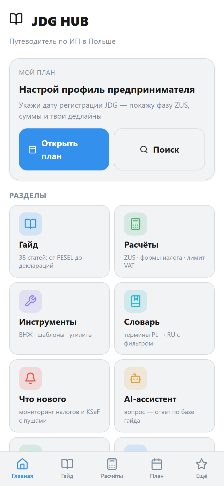
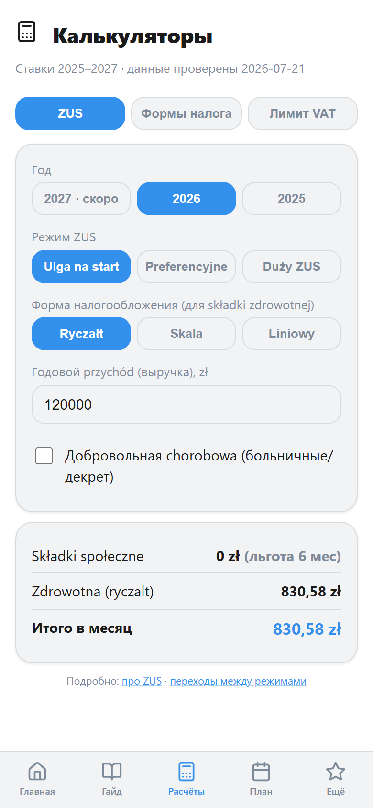
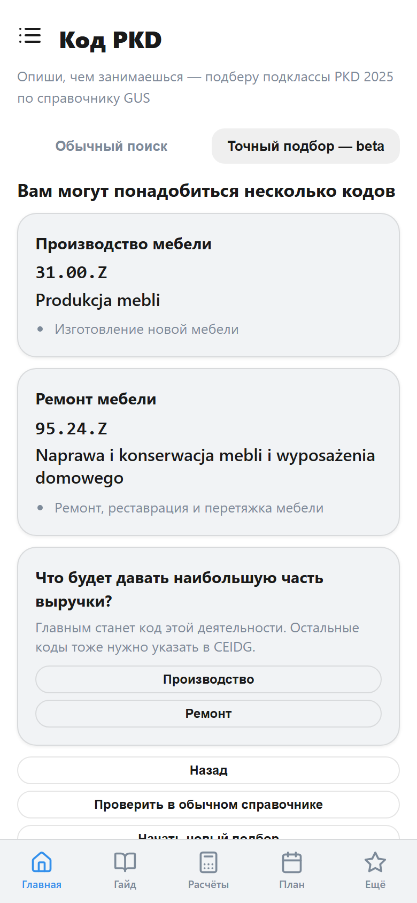
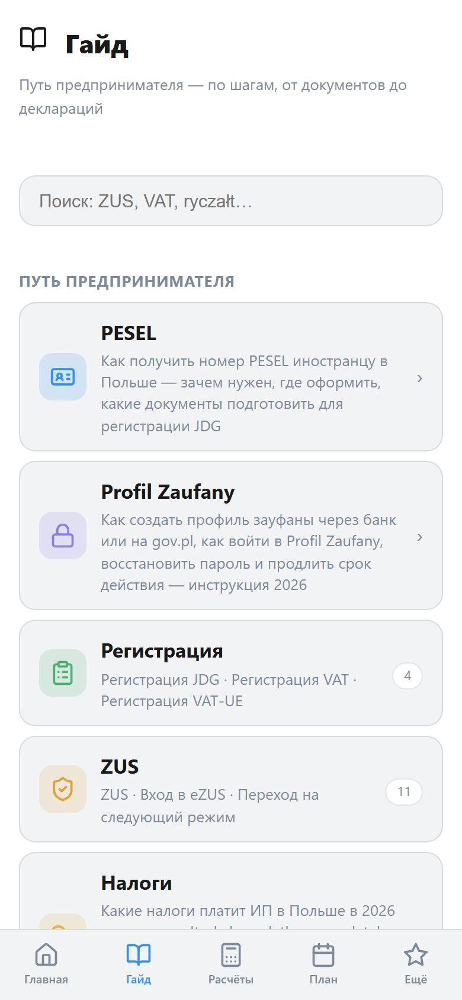

# JDG HUB — [@JGD_PL_bot](https://t.me/JGD_PL_bot)

[](https://github.com/ipostatos/JGD_Bot/actions/workflows/tests.yml)
[](LICENSE)


Telegram Mini App для русскоязычных предпринимателей с JDG (ИП) в Польше.
Гайд сообщества [JDG PBH](https://t.me/JDG_PBH), калькуляторы ZUS и налогов,
личный план с дедлайнами, подбор кода PKD, проверка контрагента, KSeF
и ассистент, который отвечает только по материалам гайда.

> Информация в приложении справочная. Это не налоговая и не юридическая консультация.

<p>
  
  
  
  
</p>

## Что умеет

| Раздел | Что внутри |
|---|---|
| **Гайд** | 38 статей гайда [twojajdg.pl](https://twojajdg.pl/) (CC0): путь предпринимателя по шагам, поиск, картинки. Рекламные врезки партнёров вырезаются при сборке |
| **Расчёты** | ZUS по годам 2025–2027 и режимам (Ulga na start, preferencyjne, duży), składka zdrowotna, сравнение skala / liniowy / ryczałt «на руки», лимит VAT. Чего ещё не объявили — так и пишем, прошлогодние цифры не подставляем |
| **Мой план** | Профиль → этапы ZUS с датами, ближайшие дедлайны (DRA, JPK, PIT), чек-листы |
| **Код PKD** | Поиск по всем 728 подклассам PKD 2025 на русском + «точный подбор»: диалог с уточняющими вопросами, несколько кодов на несколько деятельностей и выбор главного |
| **Контрагент** | Проверка NIP по White List, VIES, GUS BIR (REGON) и CEIDG; PKD с версией классификации |
| **KSeF** | Этапы, пороги, переходный период, чек-лист; личный статус по профилю и фактурам inFakt |
| **Что нового** | Мониторинг podatki.gov.pl, gov.pl и zus.pl каждые 6 часов, разметка ИИ, лента и пуши по профилю |
| **Ассистент** | Ответы по гайду, базе ошибок ZUS и ставкам. Только темы JDG; отказ по посторонним вопросам ничего не стоит |
| **Кокпит** | На данных inFakt (по ключу пользователя, read-only): год, обязательства, закрытие месяца, сверка ZUS и налога |
| **Инструменты** | Шаблоны сообщества во встроенной PDF-читалке, склейка PDF и фото для MOS прямо на телефоне |

## Как устроено

Один процесс: FastAPI (Mini App + API) и aiogram-бот, SQLite, фронтенд на
vanilla JS без сборщика. Подробно — [docs/ARCHITECTURE.md](docs/ARCHITECTURE.md).

```
server.py        FastAPI + бот, фоновые циклы (монитор, пуши, уборка)
calc.py          расчётное ядро; webapp/calc.js — его зеркало, тесты сверяют их
rates_years.json ставки ZUS/zdrowotna/PIT/VAT по годам (null = ещё не объявлено)
ai.py            ассистент: поиск по корпусу → ворота → Claude Haiku 5.5
monitor.py       скрейпинг госсайтов, разметка новостей, учёт расходов на ИИ
pkd.py           поиск PKD 2025; pkd_dialog/ — движок точного подбора
registries.py    White List, VIES, GUS BIR, CEIDG
hermes/          read-only учёт на данных inFakt (кокпит)
tools/           сборка контента гайда, справочника PKD, FAQ из чата
webapp/          Mini App: страницы, js/, тема ISSA, вендоренные pdf.js и pdf-lib
deploy/          systemd-юнит, бэкап, процедура деплоя
```

## Запуск локально

```bash
pip install -r requirements.txt
git clone --depth 1 https://github.com/sobolevbel/jdg sources/guide
python tools/build_content.py                  # гайд → webapp/data/
cp .env.example .env                           # и заполнить
DISABLE_BOT=1 uvicorn server:app --port 4400   # без поллинга, иначе 409 с продом
```

Без `ANTHROPIC_API_KEY` всё работает, кроме ассистента и разметки новостей.

## Тесты

```bash
NO_NET=1 pytest -q --ignore=test_webapp_browser.py   # логика, ~940 тестов
pip install playwright && python -m playwright install chromium
NO_NET=1 pytest -q test_webapp_browser.py            # браузерный смоук на телефонной ширине
```

`NO_NET=1` выключает живые запросы к реестрам. CI на каждый PR гоняет обе части
и собирает контент из upstream гайда.

## Данные и актуальность

- **Ставки** — `rates_years.json`, по году на запись. Новый год добавляется, когда
  объявлены цифры; неизвестное — `null`, прогноз помечен `forecast`. Калькуляторы,
  дашборд и ассистент берут ставки отсюда, второй копии нет.
- **Гайд** — upstream [sobolevbel/jdg](https://github.com/sobolevbel/jdg),
  обновление без рестарта, см. [deploy/DEPLOY.md](deploy/DEPLOY.md).
- **PKD 2025** — артефакт `data/pkd/*.json.gz` в git, собирается `tools/pkd_build.py`
  из файлов GUS.
- **Что ждёт обновления** — [CHANGELOG.md](CHANGELOG.md), раздел «Дальше».

## ИИ и расходы

Ассистент и разметка новостей работают на Claude Haiku 5.5 (~$0,001 за вопрос).
От сжигания баланса защищают: подпись Telegram, бесплатные ворота до модели
(посторонние задачи, подмена роли, низкая релевантность), дневные лимиты по ролям,
бюджет в долларах на день и месяц (`AI_*_BUDGET_USD`) и иерархия инструкций в самой
модели. Подробно — [docs/ARCHITECTURE.md](docs/ARCHITECTURE.md#ассистент-и-защита-баланса).

## Документация

- [docs/ARCHITECTURE.md](docs/ARCHITECTURE.md) — модули, потоки данных, решения
- [deploy/DEPLOY.md](deploy/DEPLOY.md) — деплой, откат, бэкапы, Caddy
- [docs/PKD_DIALOG_SPEC.md](docs/PKD_DIALOG_SPEC.md) — спецификация точного подбора PKD
- [docs/CONCEPT.md](docs/CONCEPT.md) — исходная концепция (июль 2026)
- [CHANGELOG.md](CHANGELOG.md) · [CONTRIBUTING.md](CONTRIBUTING.md) · [SECURITY.md](SECURITY.md)

## Лицензии

Код — [MIT](LICENSE). Контент гайда — CC0 (сообщество JDG PBH).
pdf.js (Apache-2.0), pdf-lib (MIT), иконки Lucide (ISC) вендорены локально.
Приложение денег не собирает; поддержать можно авторов гайда.
